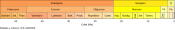
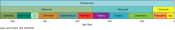
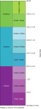

<div align="center">

# GeoEscala

**Barras de la escala de tiempo geológico con los colores y edades oficiales de la ICS, listas para tus figuras.**

**Español** · [English](README.md)

### [▶ Abrir la app](https://platicandodelatierra.github.io/geoescala/)

Sin instalar nada, sin cuenta y sin servidor: todo se calcula en tu navegador.

</div>

<!-- GIF corto de uso: grabarlo y guardarlo como docs/geoescala.gif, y quitar el comentario de la línea siguiente.

-->

## Ejemplos







Estas figuras se generan con el mismo código de la app (`node scripts/ejemplos.js`).

## Qué hace

GeoEscala dibuja una barra de la escala de tiempo, independiente, para insertarla en una figura de
tesis o de artículo:

- **Intervalo** por edad (de X a Y Ma) o por nombre (de la unidad A a la B, con un buscador que
  funciona en español o en inglés y sin importar los acentos).
- **Rangos:** eón, era, periodo, época y edad, en cualquier combinación. Donde falta un rango
  (Precámbrico, Pridoliano), la celda de arriba se extiende para cubrir el hueco, como en la carta
  oficial.
- **Horizontal o vertical**, con lo más antiguo a la izquierda o abajo, y opción de invertir.
- Escala **proporcional** (lineal en Ma) o **uniforme** (cada unidad del rango más fino del mismo
  tamaño).
- **Tamaño físico en mm**, con atajos de columna de revista (85, 120 y 175 mm).
- **Etiquetas** en español o en inglés: nombre completo → girado → abreviatura → oculto, según el
  espacio; texto negro o blanco según el contraste; cursivas en las unidades informales (Serie 2,
  Pisos 2, 3, 4 y 10); terminología **cronoestratigráfica** (Inferior/Superior, Serie/Piso) o
  **geocronológica** (Temprano/Tardío, Época/Edad).
- **Eje de edades** en Ma: marcas automáticas, a un intervalo fijo, o las edades de los límites con
  la notación de la carta (`66.00`, `3.600`), con `~` y `±` si se quiere.
- **Escala de grises** para revistas en blanco y negro, que conserva la luminancia de cada color.
- **Pie** “Edades y colores: ICS v2026/06”, para que cada figura diga qué versión de la carta usa.
- **Exportación** a SVG (texto editable), PNG a 300 o 600 dpi (con fondo transparente si se quiere y
  la resolución escrita en el archivo) y PDF vectorial, todos al tamaño exacto en mm.
- **Enlaces para compartir:** toda la configuración queda en la URL.
- Interfaz en español y en inglés, que se puede usar con el teclado.

## Datos

- **Fuente:** [Tabla Cronoestratigráfica Internacional de la ICS v2026/06](https://stratigraphy.org/chart)
  (CC BY 4.0), con los nombres de la versión en español de América (Servicio Geológico Colombiano).
- **Base de partida:** la [API de Macrostrat](https://macrostrat.org/api/v2/defs/intervals), comparada
  límite por límite con la carta y corregida donde difiere (por ejemplo, los tres pisos cuyas edades
  cambiaron en la v2026/06).
- Las edades **nunca se redondean ni se estiman**; se conserva la notación de la carta (`66.00`, `± 1.0`).
- Cada cambio respecto a Macrostrat, y cada decisión donde las cartas en inglés y en español no
  coinciden, está documentado en [`data/CHANGELOG-datos.md`](data/CHANGELOG-datos.md). Las pruebas
  revisan que no haya huecos ni traslapes, la jerarquía y un conjunto fijo de límites de control.

## Cómo citar

Si usas GeoEscala en una publicación, cita la carta y la app. El botón **Copiar cita** de la app da el
texto completo.

- **La carta** (como la propia versión en español pide citarla): Cohen, K., Harper, D., Gibbard, P. &
  Car, N. 2025 (actualizada a junio de 2026). The ICS international chronostratigraphic chart this
  decade. *Episodes*, 48(1): 105-115. https://doi.org/10.18814/epiiugs/2025/025001
- **GeoEscala:** Torres Sánchez, D. (2026). *GeoEscala* (versión 1.0.0) [software].
  https://github.com/PlaticandodelaTierra/geoescala

El repositorio incluye un archivo [`CITATION.cff`](CITATION.cff), así que el botón **Cite this
repository** de GitHub da la cita en APA y BibTeX. El DOI de Zenodo se agregará con la primera versión
publicada.

## Trabajo relacionado

El paquete de R [**deeptime**](https://CRAN.R-project.org/package=deeptime) (William Gearty) agrega
escalas de tiempo geológico a gráficas de ggplot2. GeoEscala lo complementa para quien no programa:
funciona en el navegador, tiene interfaz en español, usa la carta vigente (v2026/06) y exporta una
barra independiente a un tamaño físico exacto.

## Otras herramientas del autor

<!-- Agregar el enlace a BIRDS cuando sea público. -->
- **B.I.R.D.S — Broad Igneous Rocks: Diagrams & Statistics.** Aplicación de escritorio para graficar,
  clasificar y analizar datos geoquímicos de roca total de rocas ígneas.

## Desarrollo

Requiere [Node.js](https://nodejs.org/) 26 (ver [`.nvmrc`](.nvmrc)).

```bash
npm install
```

```bash
npm run dev
```

```bash
npm test
```

```bash
npm run build
```

- `node scripts/build-data.js` regenera `data/ics-2026-06.json` a partir de Macrostrat y de la
  transcripción de la carta en `scripts/carta-ics-2026-06.js` (requiere internet).
- `node scripts/ejemplos.js` regenera las figuras de ejemplo de `docs/ejemplos/`.
- Cada push a `main` corre las pruebas y publica el sitio en GitHub Pages
  ([`.github/workflows/deploy.yml`](.github/workflows/deploy.yml)).

## Licencia

El **código** se publica con la [licencia MIT](LICENSE). Los **datos** (edades, colores y nombres)
vienen de la carta ICS y de Macrostrat y conservan su licencia
[CC BY 4.0](https://creativecommons.org/licenses/by/4.0/): da crédito a la carta ICS si los reutilizas.

---

Darío Torres Sánchez · Platicando de la Tierra
