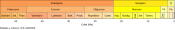
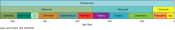
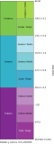

<div align="center">

# GeoEscala

**Geologic time scale bars with the official ICS ages and colors, ready for your figures.**

[Español](README.es.md) · **English**

### [▶ Open the app](https://platicandodelatierra.github.io/geoescala/)

No installation, no account, no server: everything runs in your browser.

</div>

<!-- Short usage GIF: record it and save it as docs/geoescala.gif, then uncomment the next line.

-->

## Examples







These figures are generated with the same code as the app (`node scripts/ejemplos.js`).

## What it does

GeoEscala draws a stand-alone time scale bar that you can drop into a thesis or journal figure:

- **Interval** by age (from X to Y Ma) or by name (from unit A to unit B, with a search box that works
  in Spanish or English and ignores accents).
- **Ranks**: eon, era, period, epoch and age, any combination. Where a rank is missing (Precambrian,
  Pridoli), the cell above extends to fill the gap, as on the official chart.
- **Horizontal or vertical**, oldest on the left or at the bottom, with an option to reverse.
- **Proportional** (linear in Ma) or **uniform** scale (every unit of the finest rank the same size).
- **Physical size in mm**, with journal column presets (85, 120 and 175 mm).
- **Labels** in Spanish or English: full name → rotated → abbreviation → hidden, depending on the
  space; black or white text chosen by contrast; italics for informal units (Series 2, Stages 2, 3,
  4 and 10); **chronostratigraphic** (Lower/Upper, Series/Stage) or **geochronologic** (Early/Late,
  Epoch/Age) terminology.
- **Age axis** in Ma: automatic ticks, ticks at a fixed interval, or boundary ages with the chart's
  notation (`66.00`, `3.600`), optionally with `~` and `±`.
- **Grayscale** for black-and-white journals, keeping the luminance of each color.
- **Caption** “Ages and colors: ICS v2026/06”, so every figure states the chart version.
- **Export** to SVG (editable text), PNG at 300 or 600 dpi (optionally transparent, with the resolution
  stored in the file) and vector PDF, all at the exact size in mm.
- **Shareable links**: the whole configuration is stored in the URL.
- Spanish and English interface, usable with the keyboard.

## Data

- **Source:** [ICS International Chronostratigraphic Chart v2026/06](https://stratigraphy.org/chart)
  (CC BY 4.0), with the Spanish names of the American Spanish version (Servicio Geológico Colombiano).
- **Starting point:** the [Macrostrat API](https://macrostrat.org/api/v2/defs/intervals), compared
  boundary by boundary with the chart and corrected where it differs (for example, the three stages
  whose ages changed in v2026/06).
- Ages are **never rounded or estimated**; the chart's notation is kept (`66.00`, `± 1.0`).
- Every change from Macrostrat, and every decision where the English and Spanish charts disagree, is
  documented in [`data/CHANGELOG-datos.md`](data/CHANGELOG-datos.md). The data are tested for gaps,
  overlaps, hierarchy and a fixed set of control boundaries.

## How to cite

If you use GeoEscala in a publication, please cite both the chart and the app. The app's
**Copy citation** button gives you the full text.

- **The chart** (as the chart itself asks to be cited): Cohen K, Harper D, Gibbard P, Car N. The ICS
  international chronostratigraphic chart this decade. *Episodes* 2025;48:105-115.
  https://doi.org/10.18814/epiiugs/2025/025001
- **GeoEscala:** Torres Sánchez, D. (2026). *GeoEscala* (version 1.0.0) [software].
  https://github.com/PlaticandodelaTierra/geoescala

The repository includes a [`CITATION.cff`](CITATION.cff) file, so GitHub's **Cite this repository**
button gives the citation in APA and BibTeX. A Zenodo DOI will be added with the first release.

## Related work

The R package [**deeptime**](https://CRAN.R-project.org/package=deeptime) (William Gearty) adds
geologic time scales to ggplot2 plots. GeoEscala is a complement for those who do not program: it runs
in the browser, has a Spanish interface, uses the current chart (v2026/06) and exports a stand-alone
bar at an exact physical size.

## Other tools by the author

<!-- Add the link to BIRDS when it is public. -->
- **B.I.R.D.S — Broad Igneous Rocks: Diagrams & Statistics.** A desktop application for plotting,
  classifying and analysing whole-rock geochemical data of igneous rocks.

## Development

Requires [Node.js](https://nodejs.org/) 26 (see [`.nvmrc`](.nvmrc)).

```bash
npm install
```

```bash
npm run dev
```

```bash
npm test
```

```bash
npm run build
```

- `node scripts/build-data.js` rebuilds `data/ics-2026-06.json` from Macrostrat and the chart
  transcription in `scripts/carta-ics-2026-06.js` (needs internet).
- `node scripts/ejemplos.js` regenerates the example figures in `docs/ejemplos/`.
- Every push to `main` runs the tests and publishes the site to GitHub Pages
  ([`.github/workflows/deploy.yml`](.github/workflows/deploy.yml)).

## License

The **code** is released under the [MIT license](LICENSE). The **data** (ages, colors and names)
come from the ICS chart and Macrostrat and keep their [CC BY 4.0](https://creativecommons.org/licenses/by/4.0/)
license: credit the ICS chart when you reuse them.

---

Darío Torres Sánchez · Platicando de la Tierra
